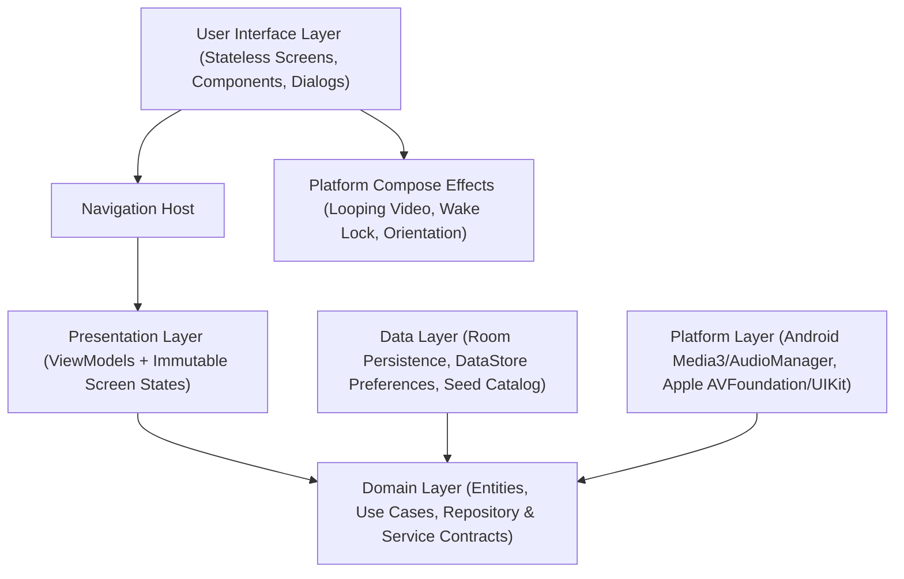
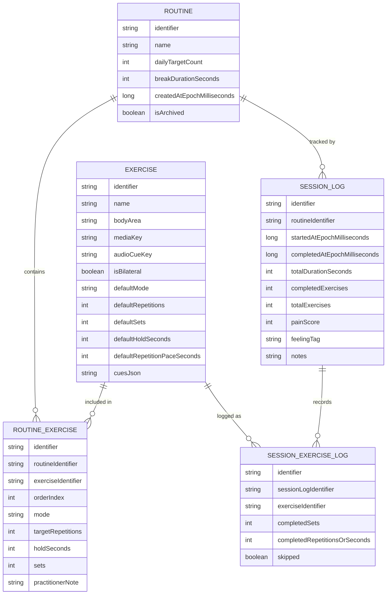
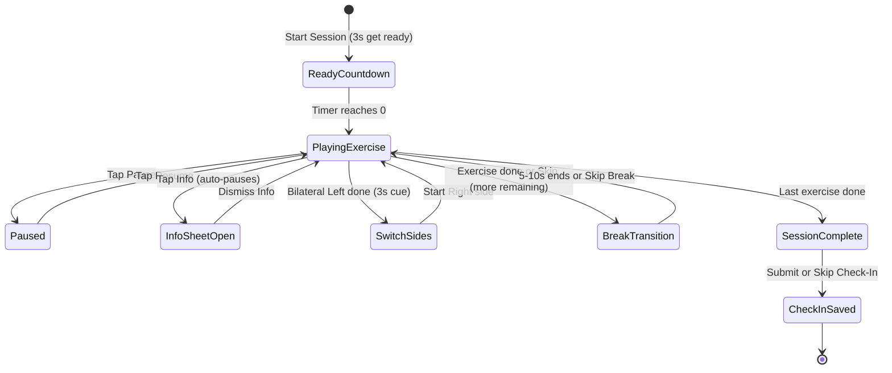

# Kindrep — Product & Clean System Architecture

> [!IMPORTANT]
> **Kindrep** (`com.jhonnyb.kindrep`) is a calm, local-first, cross-platform (**Android & iOS**) guided recovery exercise player for **any practitioner-prescribed plan** (physiotherapy, chiropractic, osteopathy, athletic therapy, sports rehabilitation, kinesiology) — built with **Kotlin Multiplatform** and **Compose Multiplatform**.

---

## 1. Product Philosophy & Safety Boundaries

### Core User Loop
`Pick exercises (single tap, sensible defaults)` → `Press Start Session` → `Hands-free looping video + automatic repetition pacer + 5–10s "Up Next" breaks` → `5-second pain and feeling check-in` → `Track consistency and recovery over time`

### Playback & Simplicity Rules
- **Simplicity by Default, Editable When Needed:** Curated exercises ship with sensible defaults (`defaultMode`, `defaultRepetitions`, `defaultSets`, `defaultHoldSeconds`, `defaultRepetitionPaceSeconds`). Adding an exercise takes a single tap; selecting an exercise customizes repetitions, sets, hold duration, or practitioner notes.
- **Hands-Free Automatic Pacing:** Repetition-based exercises pace smoothly alongside the looping video and advance automatically into the break when finished, while always allowing manual **Pause**, **Previous**, or **Next**.
- **Bilateral (`isBilateral`) Exercises:** Automatically run **Left Side → 3-second "Switch sides" transition → Right Side**.
- **Non-Prescription Safety Model:** Kindrep never prescribes exercises or diagnoses injuries. First-launch onboarding (`00 · Welcome`), the persistent information dialog on `Today`, library picker reminders, and high-pain (`4–5`) check-in banners remind users to follow their clinician's plan and stop on sharp or worsening pain.

---

## 2. Design System Tokens

| Token | Warm Earth (Light Mode) | Soft Stone D3 (Dark Mode) | Usage |
| :--- | :--- | :--- | :--- |
| `canvas` (`background`) | `#F7F5F0` *(Warm Linen)* | `#212624` *(Soft Stone)* | Screen canvas |
| `surface` | `#EFECE4` *(Soft Sand)* | `#313835` *(Lifted Moss Stone)* | Routine cards, sheets, inputs |
| `surfaceVariant` | `#E6E1D6` *(Stone Sand)* | `#3E4541` *(Elevated Stone)* | Video player stage, chips |
| `border` (`outline`) | `#DBD5C9` *(Warm Border)* | `#4D5752` *(Stone Border)* | Card and input borders |
| `primary` | `#5B7B6A` *(Calm Sage)* | `#96C2B0` *(Calm Mint)* | Primary action buttons, active navigation pill |
| `onPrimary` | `#FFFFFF` | `#18221D` | Text and icons on primary buttons |
| `secondary` | `#C87D55` *(Warm Terracotta)* | `#E0A26E` *(Soft Terracotta)* | Streaks, active limb, daily badge |
| `textPrimary` (`onBackground`) | `#232524` *(Deep Charcoal)* | `#F5F4F0` *(Warm Off-White)* | Primary floor-readable text |
| `textMuted` (`onSurfaceVariant`) | `#585D5A` | `#B6BCB8` | Captions, metadata, secondary labels |

- **Typography:** Bundled **Nunito** (`400`, `500`, `600`, `700`) with tabular numerals (`tnum`).
- **Shapes:** `18.dp` modals and sheets, `14.dp` cards / primary buttons / active navigation pill, `12.dp` inner rows and inputs, `9.dp` badges and chips.
- **Mascot & Placeholders:** Pure 2B Minimal Gentle Bunny (`Welcome`, `TodayCompanion`, `Celebration`; Dark Mode `#F2EEE6` fill + `#648977` sage border). Placeholder exercise figures use calm neutral gray (`#94989B` Light / `#D0D4D6` Dark) with terracotta active limbs.

---

## 3. Clean Architecture & Layer Boundaries

### Package Structure (`com.jhonnyb.kindrep`)
- **`domain/`** — Pure Kotlin rich domain models (`RoutineOverview`, `ExerciseSummary`), repository contracts (`OnboardingPreferencesRepository`), and service contracts (`AudioCueService`, `MediaAssetLocator`). Zero framework or user interface imports.
- **`data/`** — Repository implementations backed by local storage (Room, DataStore Preferences, bundled JSON catalog).
- **`platform/`** — Single-responsibility `expect`/`actual` contracts and effects (`LoopingExerciseVideo`, `KeepScreenAwakeEffect`, `ScreenOrientationEffect`, `PlatformAudioCueService`, `PlatformMediaAssetLocator`).
- **`presentation/`** — Feature ViewModels and immutable screen state classes (`ApplicationShellViewModel`, `ApplicationShellState`).
- **`navigation/`** — Type-safe `@Serializable` destinations (`KindrepDestination`, `TopLevelDestination`) and `KindrepNavigationHost`.
- **`ui/`** — Separated into `theme/`, `components/`, `dialogs/`, and `screens/<feature>/` — each file owning one cohesive responsibility and **one** `@Preview`.
- **`dependencyinjection/`** — Koin dependency graph wiring interfaces to implementations.

---

## 4. Domain Persistence Schema & Session State Machine

### Guided Player State Machine

